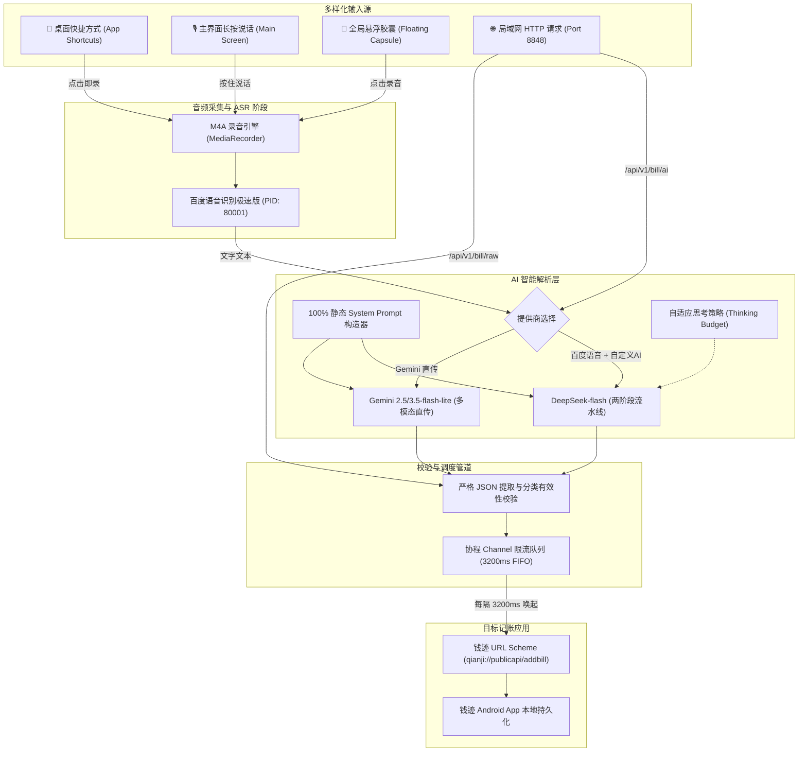

# 钱迹 AI 记账网关 (Qianji AI Bridge)

<div align="center">


### 极速双引擎 · 深度思考自适应 · 局域网 RESTful 记账网关

[](https://github.com/cuicui-V5/qianji-lite-bridge/releases/latest)
[](https://github.com/cuicui-V5/qianji-lite-bridge/actions)
[](https://developer.android.com)
[](LICENSE)
[](https://cuicui-v5.github.io/qianji-lite-bridge/)

**[🌐 访问项目官网](https://cuicui-v5.github.io/qianji-lite-bridge/)** | **[📥 下载最新 APK](https://github.com/cuicui-V5/qianji-lite-bridge/releases/latest)** | **[📖 局域网 API 文档](#-局域网-restful-api-规范)**

</div>

---

## 📖 项目简介

**钱迹 AI 记账网关 (Qianji AI Bridge)** 是一款专为配合 **[钱迹 (Android 版)](https://qianji.app)** 自动化记账接口设计的轻量级个人智能记账枢纽。

传统记账的痛点显而易见：
* **输入繁琐**：每次消费后需要打开应用、选择账本、翻找多级分类、输入金额、挑选账户并填写备注。
* **语言死板**：传统语音记账只能按照固定句式（“记一笔支出二十元零食”），一旦说“在便利店买了一包烟25微信付的，顺便买了瓶冰可乐3块”便无法正确处理。
* **多笔拆分困难**：一句话中包含多笔收支或复合消费时，无法一次性解析拆解。
* **设备割裂**：智能手表、iOS 快捷指令、智能家居或桌面自动化脚本无法简单地将账单汇入钱迹。

**钱迹 AI 记账网关** 通过将 **百度语音极速版转写 + DeepSeek-flash 深度思考大模型**（或 **Gemini 2.5/3.5-flash-lite 原生多模态**）深度整合，结合 **100% 静态 Prompt 上下文缓存** 与 **钱迹 3.2s 智能限流防刷队列**，让您只需口语化说出一句话，即可在 **1.7 秒内** 自动完成多笔复合账单的高精度提取并平稳存入钱迹。同时暴露局域网 HTTP API，赋予全屋设备无缝记账能力。

---

## 🌟 核心功能与亮点

### 1. ⚡ 极速双引擎记账流水线
* **模式一（推荐·极致响应）：百度语音识别极速版 + DeepSeek-flash (两阶段流水线)**
  * **录音转写**：采用百度语音极速版（`PID: 80001`）引擎，中文转写耗时仅 **~600ms**。
  * **语义理解**：调用 DeepSeek-flash 或任何兼容 OpenAI 接口的大模型，自动提取金额、类型、分类、账户、账本与备注。
  * **端到端耗时**：端到端仅需 **~1.7 秒** 即可完成从语音输入到钱迹唤起落库。
* **模式二（原生多模态直传）：Gemini Flash 原生音频理解**
  * 使用 Google 官方 `com.google.genai` SDK，将 M4A 音频直传给 `gemini-2.5-flash` / `gemini-3.5-flash-lite`，由多模态大模型直接听音并解析账单。

### 2. 🧠 深度思考智能自适应 (Reasoning Effort)
* 针对 DeepSeek 与现代思考大模型设计了**自适应思考策略**：
  * **关闭 / 低 / 高 / 智能自动** 四档可选。
  * **智能自动模式（默认启用）**：当识别文本字数 ≤ 阈值（默认 20 字）时，自动关闭推理（`thinking: false`），以毫秒级极速直出；当超过阈值（如复合复杂长句）时，自动启用轻度思考（`thinking: low`），兼顾极端复杂语义逻辑与闪电般响应。

### 3. 🚀 100% 静态 Prompt 上下文缓存 (Context Caching)
* 针对大语言模型 Prefix Caching 机制进行底层重构：
  * 将动态生成的系统手机时间从 System Prompt 移出，后置到用户输入内容正前方（`当前手机系统准确时间: ...\n用户记账输入内容: ...`）。
  * 使得长达上千字庞大的 System Prompt（包含所有分类表、账户映射与 JSON Schema 范例）达到 **100% 静态相同前缀**，全面吃满 DeepSeek 与 Gemini 的前缀缓存，首字延迟骤降 90%，大幅节省 Token 成本。

### 4. 📱 Android App Shortcuts 桌面长按一键记账
* 深度适配 Android 桌面快捷方式（App Shortcuts）：
  * 长按桌面应用图标，轻触 **“快速语音记账”**。
  * 瞬间拉起应用并自动直接进入录音状态，点按轻触即停，行云流水。
  * 原生主界面依旧保持“长按说话、松手结束”的沉浸手感。

### 5. 🎈 全局悬浮记账胶囊 (Floating Capsule)
* 无需离开当前前台应用（如微信收付款、美团外卖、淘宝结算或正在运行的游戏）：
  * 屏幕边缘常驻极简半透明悬浮胶囊。
  * 单手轻触胶囊即可立刻录音，再次轻触提交后台 AI 流水线，账单自动唤起记账后自动切回。

### 6. 🌐 局域网 RESTful 统一记账网关 (Port: 8848)
* 内置轻量级高并发 NanoHTTPD 服务器，手机常亮时自动对外暴露 `0.0.0.0:8848`：
  * 支持 iOS 快捷指令（Action Button 联动）、智能手表、Tampermonkey 油猴脚本、Python/Node.js 自动化脚本。
  * 支持传入自然语言文本由网关解析，或直接传入已格式化的结构化账单 JSON。

### 7. 🛡️ 3.2s 智能限流防刷队列 (Strict FIFO)
* 严格遵循钱迹官方“3 秒内只能调用一次”的防刷限流机制：
  * 所有来自语音、悬浮窗、以及局域网的高并发记账请求统一汇入协程 `Channel<BillItem>` 队列。
  * 局域网 HTTP 接口在入队后毫秒级返回 `200 OK (Queued)`。
  * 后台协程以 **3,200ms / 笔** 的平稳节奏依次触发 URL Scheme 唤起钱迹并切回网关，彻底避免多笔拆分或并发请求触发钱迹防刷阻断。

### 8. 📳 高拟真触觉震动反馈 (Haptic Vibration)
* 录音按钮按下瞬间触发沉稳厚重的触觉反馈（`EFFECT_HEAVY_CLICK`），告知麦克风已成功收音。
* 松开或点按停止瞬间触发清脆明快的确认反馈（`EFFECT_CLICK`），盲操同样信心十足。

### 9. 📊 已识别账单历史看板 & 120 FPS 满帧硬件加速日志
* **主界面账单看板**：首行展示精致分类徽标与备注加粗、右侧醒目金额（支出红色、收入绿色），底行紧凑呈现精确时间与账本名称。
* **120 FPS 丝滑控制台**：剔除传统多节点重排开销，采用单节点 `buildAnnotatedString` 结合内存缓存，纯 GPU 硬件文本光栅化渲染，数千行彩色日志依然满帧流畅滑动。

### 10. 🛡️ 分类校验与容错重试保护
* 自动比对用户自定义分类，防止大模型幻觉出不存在的分类名；针对 JSON 模式下偶尔返回空内容的极端情况具备自动重试 1 次保护。

---

## 🏗️ 系统架构与执行流程



---

## 🚀 快速上手

### 1. 下载安装
前往 [GitHub Releases](https://github.com/cuicui-V5/qianji-lite-bridge/releases/latest) 下载最新的 `app-debug.apk` 并安装在运行 Android 8.0 至 Android 16+ 的设备上。

### 2. 基础权限配置
* **麦克风权限 (`RECORD_AUDIO`)**：用于语音输入（首次启动会弹出授权提示）。
* **网络权限 (`INTERNET`)**：用于请求 AI 接口与启动局域网 HTTP 网关。
* **悬浮窗权限 (`SYSTEM_ALERT_WINDOW`)** *(可选)*：若需使用屏幕边缘悬浮胶囊，在应用内轻触“开启悬浮胶囊”授权即可。
* **电池优化白名单** *(推荐)*：为确保手机熄屏或长时间放置时局域网网关正常工作，请将本应用加入系统的“无限制 / 允许后台高耗电”白名单。

### 3. 配置服务提供商
打开应用右上角 **设置** 图标，根据需求配置：

#### 方案 A：百度语音极速版 + DeepSeek (推荐，极速 1.7s)
1. **语音识别服务商**：选择 `百度语音识别`。
   * 登录 [百度智能云语音技术平台](https://console.bce.baidu.com/ai/#/ai/speech/overview/index)，免费开通并创建应用，获取 `AppID`、`API Key`、`Secret Key` 填入设置中。
2. **AI 服务提供商**：选择 `自定义 AI 提供商`。
   * **API 地址**：`https://api.deepseek.com/v1/chat/completions` (或第三方兼容中转地址)
   * **API Key**：填入你的 DeepSeek API Key
   * **模型名称**：`deepseek-flash`
   * **思考强度**：选择 `自动`（推荐阈值 20 字，超过启用 low 推理）

#### 方案 B：Gemini 原生多模态直传
1. **AI 服务提供商**：选择 `Gemini`。
   * 登录 [Google AI Studio](https://aistudio.google.com/) 免费获取 API Key。
   * 填入 Gemini API Key，模型选择 `gemini-2.5-flash` 或 `gemini-3.5-flash-lite`。

### 4. 账本与分类映射
在设置页面下方，可根据你的钱迹实际分类与账本名称进行自定义配置（英文逗号 `,` 分隔）。AI 会优先匹配你所配置的分类和账本，杜绝随意捏造。

---

## 🌐 局域网 RESTful API 规范

App 前台启动或常驻运行时，将自动监听 `0.0.0.0:8848`。局域网内任何设备均可通过 HTTP 调用以下接口：

### 1. 状态查询
* **请求路径**：`GET /api/v1/status`
* **响应示例**：
```json
{
  "code": 200,
  "status": "running",
  "port": 8848,
  "queue_size": 0,
  "version": "1.4.3"
}
```

### 2. 自然语言代调 AI 解析记账
* **请求路径**：`POST /api/v1/bill/ai`
* **Content-Type**：`application/json`
* **请求体**：
```json
{
  "text": "中午在公司食堂吃午餐花了22元微信付的，下午坐地铁回家人人通刷卡4元"
}
```
* **响应示例**（毫秒级入队）：
```json
{
  "code": 200,
  "message": "Queued",
  "count": 2,
  "bills": [
    {
      "type": 0,
      "money": 22.0,
      "time": "2026-10-16 12:30:00",
      "remark": "公司食堂午餐",
      "catename": "餐饮",
      "accountname": "微信",
      "bookname": "日常账本"
    },
    {
      "type": 0,
      "money": 4.0,
      "time": "2026-10-16 18:10:00",
      "remark": "地铁回家人人通",
      "catename": "交通",
      "accountname": "人人通",
      "bookname": "日常账本"
    }
  ],
  "queue_size": 2
}
```

### 3. 结构化账单直通入队
* **请求路径**：`POST /api/v1/bill/raw`
* **请求体**（支持单个 JSON 对象或数组）：
```json
[
  {
    "type": 0,
    "money": 35.5,
    "time": "2026-10-16 12:30:00",
    "remark": "星巴克美式咖啡",
    "catename": "餐饮",
    "accountname": "招商银行",
    "bookname": "日常账本"
  }
]
```
* **字段说明**：
  * `type`: 记账类型，`0` 为支出，`1` 为收入，`2` 为转账。
  * `money`: 金额（浮点数，大于 0）。
  * `time`: 记账时间，格式统一为 `yyyy-MM-dd HH:mm:ss`。
  * `remark`: 账单备注。
  * `catename`: 分类名称（可二级分类，格式 `一级/::/二级`）。
  * `accountname`: 资产账户名称（如 `微信`、`支付宝`、`招商银行`）。
  * `bookname`: 账本名称。

---

## 🛠️ iOS 快捷指令联动接入

在 iPhone 的“快捷指令” App 中，使用 **获取 URL 内容** 动作向运行本网关的 Android 手机发送 POST 请求：
1. **URL**：`http://{安卓手机局域网IP}:8848/api/v1/bill/ai`
2. **方法**：`POST`
3. **请求头**：`Content-Type: application/json`
4. **请求体**：选择 JSON，键 `text`，值填入听写文本或 Siri 输入。
5. 绑定到 iPhone 15/16 Pro 的 **Action Button（操作按钮）**，一按即实现跨生态秒级语音记账！

---

## 💻 源码编译构建

本工程采用现代 Android 标准 Gradle 架构（Kotlin 2.0 + Jetpack Compose + Material 3）：

```bash
# 1. 克隆代码仓库
git clone https://github.com/cuicui-V5/qianji-lite-bridge.git
cd qianji-lite-bridge

# 2. 赋予 Gradle Wrapper 执行权限 (Linux/macOS)
chmod +x gradlew

# 3. 编译生成 Debug APK
./gradlew assembleDebug

# 产物输出路径: app/build/outputs/apk/debug/app-debug.apk
```

---

## 📄 鸣谢与协议

* 核心受惠于 **[钱迹 (Qianji)](https://qianji.app)** 开放的自动化记账接口规范。
* 本项目依据 **[MIT License](LICENSE)** 协议完全开源。欢迎 Star、Fork 或提交 Pull Request！
