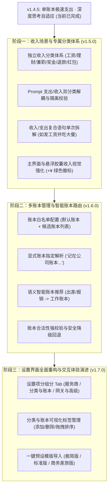

# 钱迹 AI 记账网关 (Qianji AI Bridge) - 演进与规划路线图 (TODO)

> 本文档记录后续重点迭代规划：**收入场景专属支持**、**多账本智能路由**、以及**设置界面全新重构**。

---

## 📌 规划背景与核心挑战

当前版本（`v1.4.5`）已对**单账本日常支出记账**实现了极致轻量化与极速毫秒级响应（端到端 1.0~1.7s）。随着记账场景的深化，用户对**收入记录**与**跨账本记账**提出了更精细化的需求。

### 核心痛点与技术挑战
1. **支出与收入分类冲突**：
   - 支出分类（如三餐、交通、数码）与收入分类（如工资、理财、兼职）属于完全不同的维度。若混在同一列表中，模型在极速直出模式下容易产生分类错乱（例如把“兼职收入500”错误分类到“三餐”或“其它”）。
   - 需要两套分类体系在 Prompt 中清晰解耦、按 `type` 精准路由。
2. **多账本匹配与幻觉防护**：
   - 钱迹中每个账本名称必须在 App 本地真实存在。如果 AI 幻觉出不存在的账本名（如“差旅费”），调用钱迹 API 会直接报错中断。
   - 需要在设置中建立账本白名单，并支持“指定账本优先、缺省使用默认账本、不存在时自动兜底”的三级保障机制。

---

## 🗺️ 功能演进规划路线图



---

## 🎯 详细任务拆解与设计规格

### 阶段一：收入场景专属支持 (Target: v1.5.0)

#### 1. 独立收入分类体系设计
* **预设默认收入分类列表**：
  ```text
  工资薪水, 理财收益, 兼职副业, 奖金补贴, 报销到账, 亲友红包, 退款返还, 其它收入
  ```
* **PreferencesManager 数据结构扩展**：
  - 新增 `KEY_INCOME_CATEGORIES` 与默认值 `DEFAULT_INCOME_CATEGORIES`。
  - 保留原有 `KEY_CATEGORIES` 作为 `KEY_EXPENSE_CATEGORIES`。

#### 2. System Prompt 提示词重构
* **分类隔离规范**：
  ```text
  【支出可用分类】（当 type=0 时必须且只能从以下分类中选择）：
  三餐, 交通, 零食, 衣服, 日用品, 旅行, 学习, 住房, 美妆, 话费网费, 医疗, 娱乐, 汽车/加油, 请客送礼, 电器数码, 水电煤, 其它, 数字订阅

  【收入可用分类】（当 type=1 时必须且只能从以下分类中选择）：
  工资薪水, 理财收益, 兼职副业, 奖金补贴, 报销到账, 亲友红包, 退款返还, 其它收入
  ```
* **动词与语义规则补充**：
  - 支出触发词：`花了`、`买了`、`支出了`、`吃了`、`消费` -> `type: 0`
  - 收入触发词：`发了`、`到账`、`赚了`、`收益`、`收入`、`奖金`、`收到红包` -> `type: 1`
  - 动宾提纯：收入备注同样提纯为纯净名词（如“余额宝收益”、“9月工资”、“设计兼职款”）。
* **Few-Shot 双向示范**：
  - 示例 A：单笔收入（如“余额宝收益 10000.00”，`type: 1`，分类“理财收益”）
  - 示例 B：单次复合收支拆解（如“发了8000块工资，晚上和同事聚餐花了200”，自动拆解为 1 笔收入 + 1 笔支出）

#### 3. 本地解析与校验层（BillPromptHelper）适配
- 校验器逻辑分流：
  - 若 `item.type == 1`：自动使用用户配置的 `incomeCategories` 校验和纠偏映射。
  - 若 `item.type == 0`：继续使用 `expenseCategories` 校验。

---

### 阶段二：多账本管理与智能路由 (Target: v1.6.0)

#### 1. 账本配置体系升级
- **配置项**：
  - `defaultBook`：默认账本名称（如 `日常账本`）。
  - `availableBooks`：可用账本列表，英文逗号分隔（如 `日常账本, 工作报销, 家庭账本, 旅行专项`）。

#### 2. 账本路由三级匹配机制
1. **显式指定（最高优先级）**：
   - 用户语音明确提及账本名称（如“记在工作账本：打车花了45元”），直接提取 `bookname: "工作账本"`。
2. **语义智能归类（次高优先级）**：
   - 规则与模型协同识别特定场景（例如出差打车、办公用品且用户配置了“工作报销”账本时，引导自动归入该账本）。
3. **默认账本兜底（基础保障）**：
   - 未指定或模型未推测出时，统一填写 `defaultBook`。
4. **安全校验网**：
   - 本地 `BillPromptHelper` 比对 `availableBooks`，若模型输出的账本不存在，自动纠错回退为 `defaultBook`，杜绝调用钱迹失败。

---

### 阶段三：设置界面全面重构 (Target: v1.7.0)

#### 1. 分组标签卡片（Tabbed Settings）
随着设置项增多，将单页流式布局升级为清晰的 **三栏式 / 标签页布局**：
* 🏷️ **服务与模型**：
  - 语音识别提供商（百度语音极速版 / Gemini ASR）与密钥管理。
  - AI 大模型提供商（DeepSeek / 自定义 OpenAI / Gemini）与接口地址、模型名。
  - 思考强度控制（关 / 低 / 高 / 自动阈值调节）。
* 📚 **分类与账本**：
  - 支出分类列表（支持单行/多行便捷编辑）。
  - 收入分类列表（新增）。
  - 账本管理（默认账本 + 候选账本列表）。
  - “恢复预设推荐分类”一键重置按钮。
* ⚙️ **系统与高级**：
  - 局域网 HTTP 网关配置（端口 8848、开关状态、IP 查看）。
  - 全局悬浮胶囊开关与重置位置。
  - 记账后自动返回开关。
  - 实时日志控制台。

#### 2. 分类管理可视化改进
- 支持以 FlowRow 胶囊标签展示现有分类，支持直接点按编辑或删除。

---

## 📝 长期探索备忘 (Backlog)

- [ ] **资产账户联动（Account Name）**：仅在用户有强诉求时开启，支持“微信/支付宝/招商银行”资产账户映射。
- [ ] **转账与信用卡还款（Transfer & Repayment）**：针对 `type: 2`（从 A 账户转至 B 账户）的专项语法支持。
- [ ] **多模态图片记账扩展**：局域网 API 增加 `POST /api/v1/bill/image`，支持小红书截图、微信支付凭证直接拍照 OCR 识图记账。
